<div align="center">

# FLUJO

### Build private AI agents visually. Run them your way.

**Connect your AIs and apps, build an agent, then talk to it, automate it, or call it from other software.**

**Simple + visual builders** · **MCP-native connections** · **Multi-model** · **Built-in debugger** · **Automation**

[**Install FLUJO ↓**](#-quick-install-recommended) · [**Explore features ↓**](#-key-features) · [**Watch the walkthrough →**](https://flujo.com.co/film/) · [**Website →**](https://flujo.com.co/) · [**Online demo →**](https://try.flujo.com.co/)

[](LICENSE)
[](package.json)

</div>

FLUJO is an open-source, local-first AI workspace. Save your model and app connections once, build reusable agents as plain-language steps or visual flows, and inspect what happens when they run. Combine models, tools and other agents; branch, loop and hand off work; use the same setup in chat, background automations and external applications.

Your workspace is stored on your computer. Cloud models and connected services receive the requests you send them. [Privacy and workspace controls](#privacy-and-workspace-controls).

[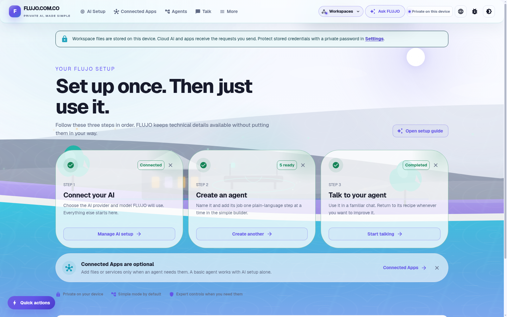](githubpages/film/media/walkthrough/act1-dashboard.png)

*Connect your AI, create an agent, then use it. Walkthrough screenshots show real FLUJO 3.46.2 screens; select an image to view it at full size.*

> FLUJO feels complicated, you're missing a feature, or you're stuck? [Join Discord](https://discord.gg/KPyrjTSSat) or [open a GitHub issue](https://github.com/mario-andreschak/FLUJO/issues). **We can only improve if we know what's wrong.**

[AI Setup](#ai-setup) · [Connected Apps](#connected-apps-mcp) · [Agent Builder](#agent-builder) · [Talk & debugging](#talk-and-debugging) · [Automations](#automations) · [Meetings](#meetings--experimental) · [Personas](#personas-and-roles--experimental) · [Integrations](#external-tool-integration) · [Project vision](#project-vision--soontm)

<a id="-quick-install-recommended"></a>

## Quick install

The installers set up FLUJO and useful tool runtimes such as Git, Node.js, Python, uv and ripgrep. They download dependencies and need an internet connection.

**Windows installer:** [Download the latest flujo-setup.exe](https://github.com/mario-andreschak/FLUJO/releases/latest/download/flujo-setup.exe).

**Windows PowerShell:**

```powershell
irm https://raw.githubusercontent.com/mario-andreschak/FLUJO/main/scripts/install.ps1 | iex
```

**Linux / macOS:**

```bash
curl -fsSL https://raw.githubusercontent.com/mario-andreschak/FLUJO/main/scripts/install.sh | bash
```

**Already have Node.js 22.19+ within 22.x, or 24.2+ within 24.x?** Run the published package:

```bash
npx flujo-ai@latest
```

Open [localhost:4200](http://localhost:4200) and keep the FLUJO server running. Some connected tools need additional runtimes or credentials. Shell installers follow the development branch by default; check the release notes for a Windows installer's version and channel.

[All installation choices](docs/start-here/install.md) · [Windows](docs/start-here/windows.md) · [Linux/macOS](docs/start-here/unix.md) · [npm](docs/start-here/npm.md) · [Docker](docs/start-here/docker.md) · [Build from source](docs/start-here/source.md)

<a id="-key-features"></a>

## Key features

### AI Setup

- **Choose your provider:** OpenAI, Azure OpenAI, Anthropic, Google Gemini, X.ai, OpenRouter, supported subscription connections, or local models through Ollama.
- **Guided or expert setup:** use a gentle walkthrough, a faster guided path or the complete configuration form. Test the saved connection before using it.
- **Subscription and CLI options:** Claude Subscription uses the Claude Agent SDK; Codex and the bundled Antigravity CLI have their own login and host requirements. Provider access and allowance still apply.
- **Reuse and organize:** keep connections in folders, mark favorites and select different models for different AI steps.
- **Fallback policies:** try ordered backup connections for selected limits or outages, before output or tool activity begins.

[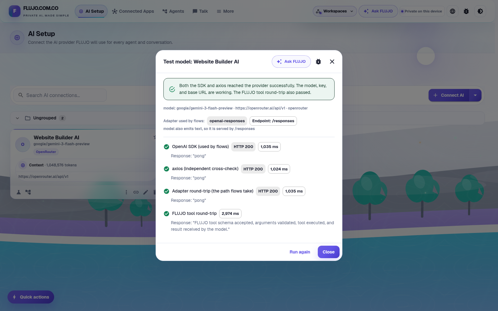](githubpages/film/media/walkthrough/act1-model-test-success.png)

[Model connections and supported logins](docs/features/models/connecting.md) · [Model settings](docs/features/models/settings.md) · [Fallback behavior](docs/features/model-fallback-policies.md)

### Connected Apps (MCP)

Give agents access to files, browsers, APIs and other services through the **Model Context Protocol**.

- **Connect your way:** curated apps, the [MCP Registry](https://registry.modelcontextprotocol.io), a remote URL, a GitHub repository or a local command. AI-assisted setup can help configure the connection.
- **More than tools:** browse tools, resources and reusable prompts; configure roots and opt-in model sampling where supported.
- **Inspect before attaching:** call tools and inspect resources from the connected server's detail view. A saved connection and a successful operation are separate checks.
- **Interactive MCP Apps:** compatible tools can return an interface inside chat. Enable Apps for the connection; support depends on the server's declared capabilities.
- **Reuse outside FLUJO:** explicitly expose a configured server through FLUJO's local MCP proxy for another compatible client.

[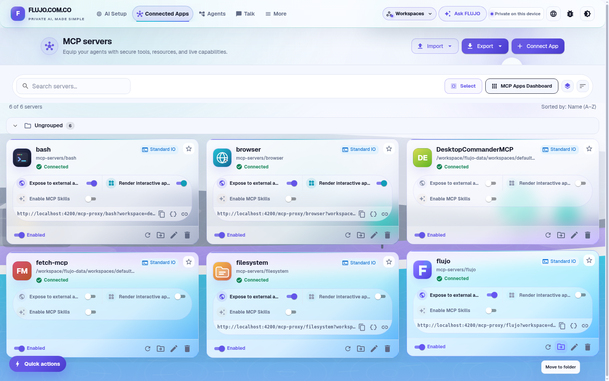](githubpages/film/media/walkthrough/act2-desktop-commander-connected.png)

<details>
<summary>GitHub setup and the tool inspector</summary>

Import a repository, install and build its server, configure its run command, then test and save the connection.

[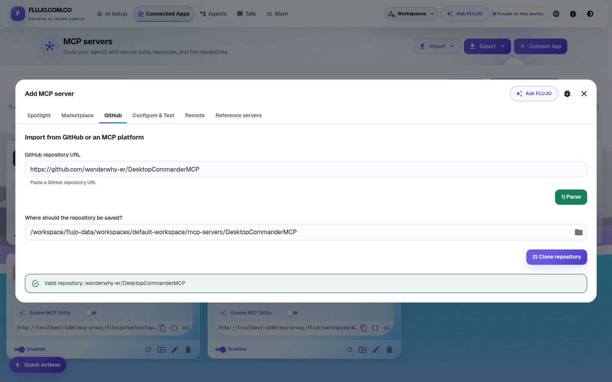](githubpages/film/media/walkthrough/act2-github-parsed.png)

The tool inspector lets you browse and call a connected server's capabilities directly:

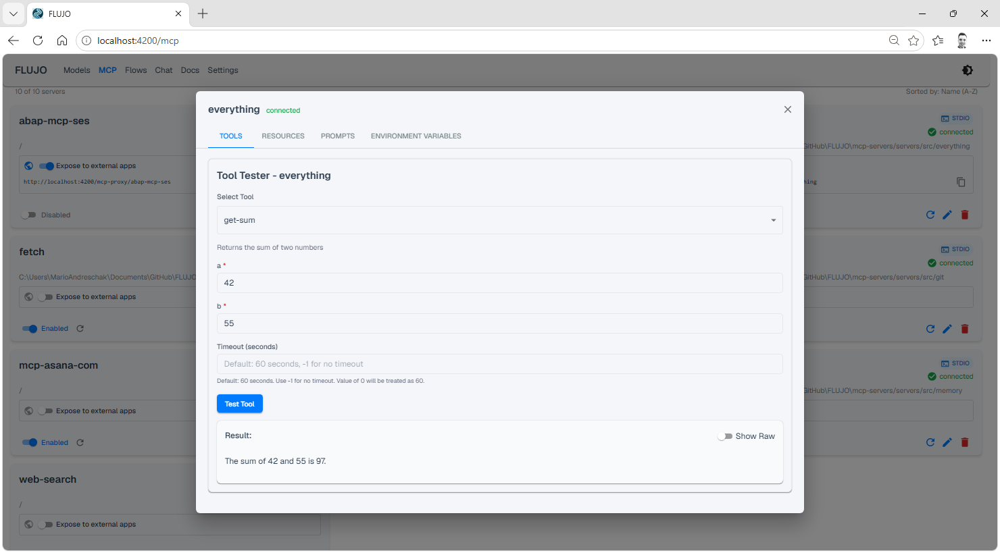

</details>

[Connected Apps guide](docs/features/mcp/overview.md) · [GitHub setup](docs/features/mcp/github-servers.md) · [Interactive Apps and limits](docs/features/mcp/apps.md)

### Agent Builder

Start simple, then add the structure your task needs.

- **Easy mode:** build an agent like a recipe, one plain-language step at a time.
- **Expert visual mode:** connect Start, AI, connected-app, Static, Subflow and Finish nodes in a graph.
- **Branching and handoff:** let a model choose the next specialist or path based on the conversation.
- **Loops:** return to an earlier step for another pass.
- **Subflows:** reuse another flow as a step, with configurable input context and output handling.
- **Per-step scope:** choose each AI step's model, instructions, tools and resources. Review AI-generated flows before running them.

[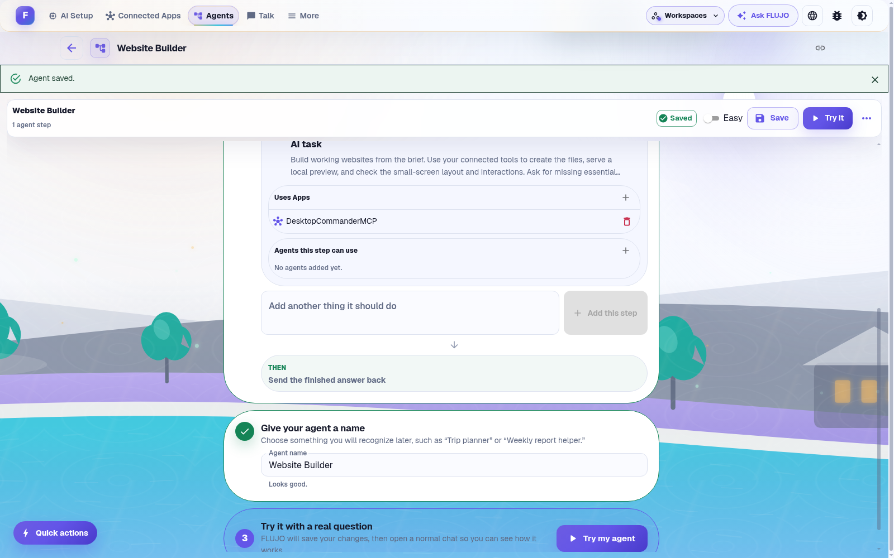](githubpages/film/media/walkthrough/act3-agent-saved.png)

*Easy and Expert are views of the same agent. This recording uses a Website Builder as one example.*

[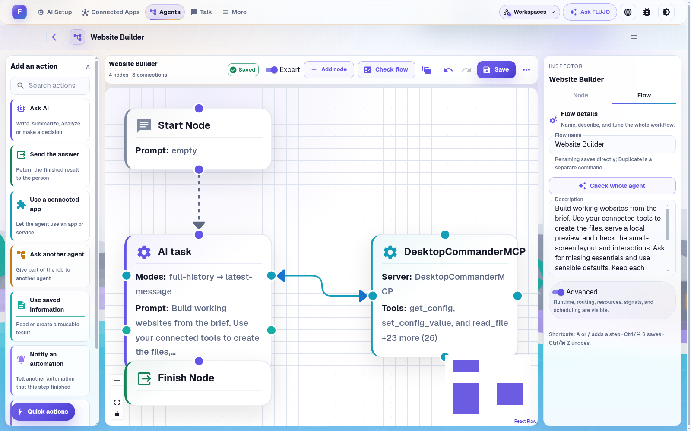](githubpages/film/media/walkthrough/act3-expert-graph.png)

#### Branching, loops and orchestration

Connect one node to several successors, then describe when its handoff tools should choose each path. Connect a node back to an earlier step to create a loop. Combine these patterns to coordinate several specialists.


<details>
<summary>Handoff tools, loops and orchestration examples</summary>


</details>

<a id="orchestration--subflows"></a>

#### Reusable subflows

Drop in a **Subflow** node to call another flow. Choose what context it receives and how its output appears in the parent run.

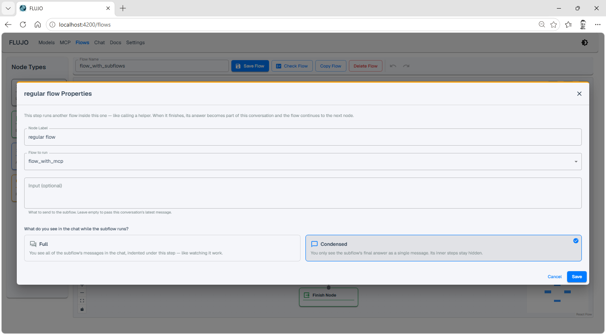

[Node reference](docs/features/flows/README.md) · [Context and output modes](docs/features/README.md#process-node-vs-subflow-node-inputoutput-modes)

### Talk and debugging

- **One place for every agent:** select a saved agent in **Talk**, then start or resume a conversation.
- **Live execution view:** follow steps and tool results, with model usage and a context-window meter.
- **Visual debugger:** set breakpoints, step through nodes, and inspect state before and after execution.
- **Optional tool approvals:** review tool calls before they run. Approvals control actions; they do not sandbox local programs.
- **Files, audio and revisions:** attach supported files or audio, edit a message, or branch the conversation to try a different direction.

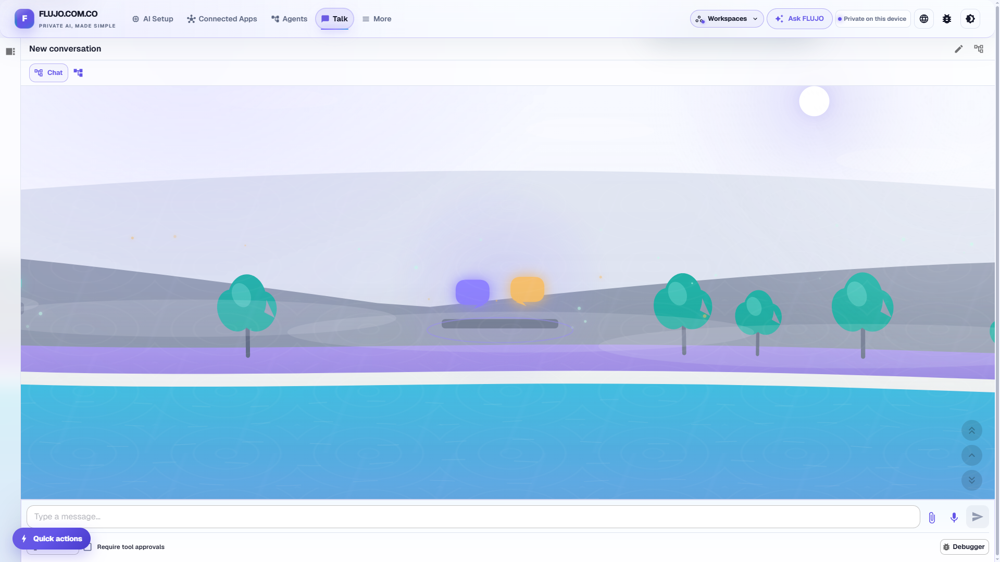

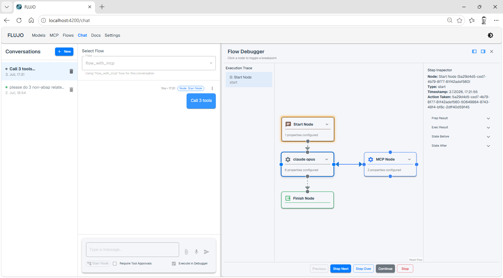

[Run and debug agents](docs/features/flows/running-flows.md) · [Chat commands and dynamic references](docs/features/dynamic-references.md)

### Automations

Run a saved agent on a schedule or when something happens. **The FLUJO server must stay running; the browser tab can be closed.**

| Trigger | Example |
| --- | --- |
| Schedule | Prepare a daily report or run on a custom cron schedule |
| Webhook | Start work from an authenticated call by another service |
| File changes | Process a file when it appears or changes in a watched folder |
| Watch a tool | Poll an MCP tool and react to changed results or new items |
| Website changes | React when fetched page content changes |
| Another flow finishes | Chain work after a flow completes or fails |

[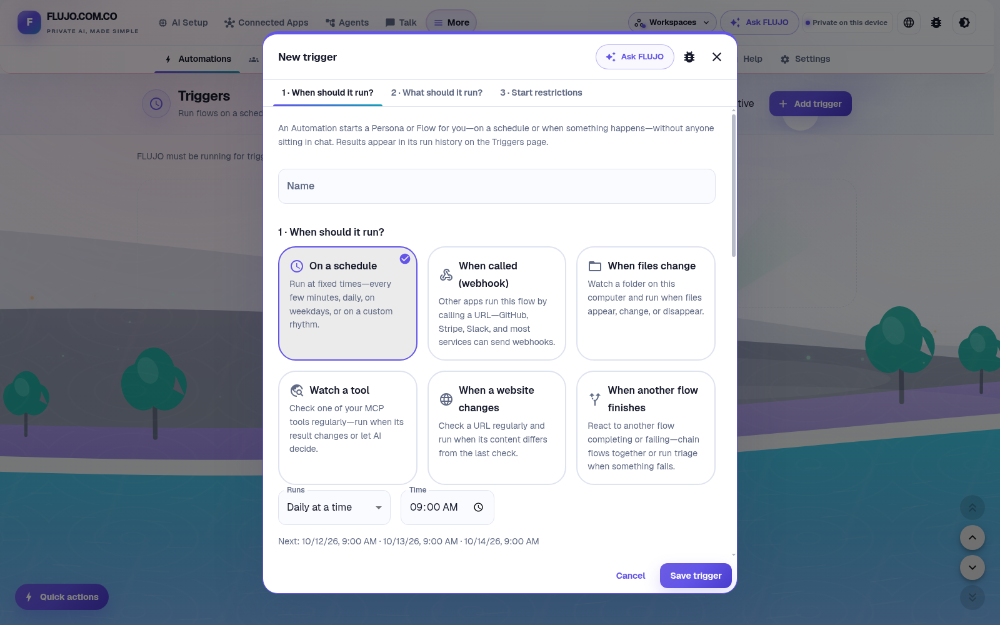](githubpages/film/media/walkthrough/act5-trigger-options.png)

*Choose what starts the work. Each saved trigger has its own run history and results.*

<details>
<summary>Run history and the WhatsApp example</summary>

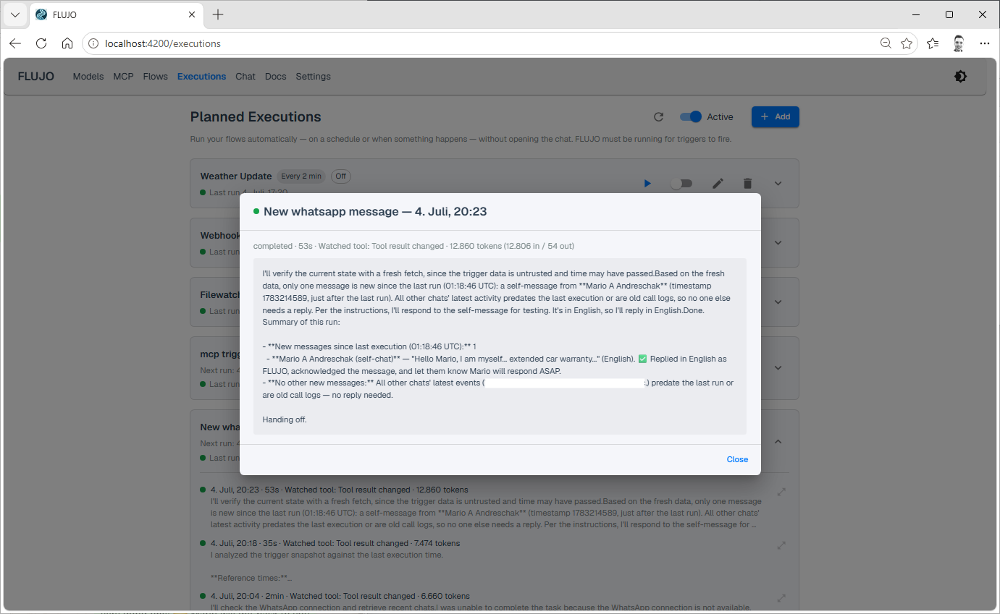

Combine a **Watch a tool** trigger with a WhatsApp MCP server to build an auto-responder. Its operation depends on the connected server, account access and agent configuration.

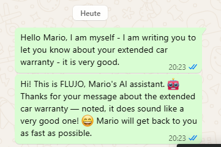

</details>

Failed tools, provider limits and approvals can need attention. Schedule catch-up can admit one missed occurrence; it does not replay every missed run. The Triggers page retains saved schedules during refresh errors and offers **Try again**. Pause changes wait for confirmation, failed deletions remain retryable, and stalled requests release the controls after 30 seconds.

[Automation setup and recovery](docs/start-here/using-flujo.md#schedule-work-after-a-manual-run-succeeds) · [Scheduled occurrence accounting](docs/features/scheduled-occurrences.md)

### Meetings — experimental

Bring multiple agents into a shared conversation around a topic. Choose participants and facilitation in **More → Meetings**.

[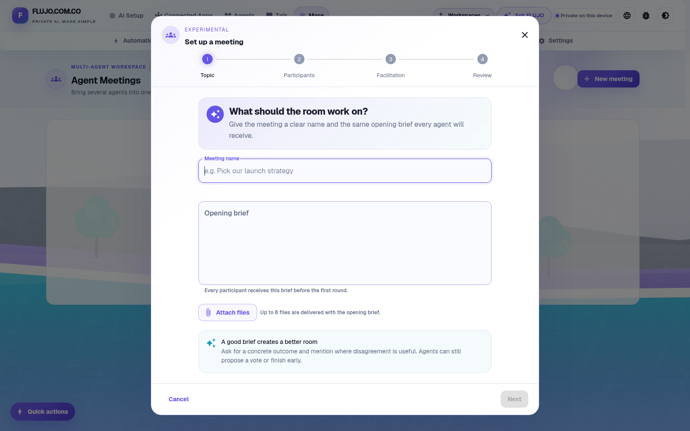](githubpages/film/media/walkthrough/act5-meeting-setup.png)

*The walkthrough previews this setup without creating or running a meeting.*

<details>
<summary>Earlier multi-agent meeting example</summary>


</details>

### Personas and Roles — experimental

A Persona is an ongoing helper with a name, a Role, memories, conversations and goals. Review its work and memories, adjust its setup, and pause or stop ongoing goals. Enable experimental features in **Settings** to explore Personas.

[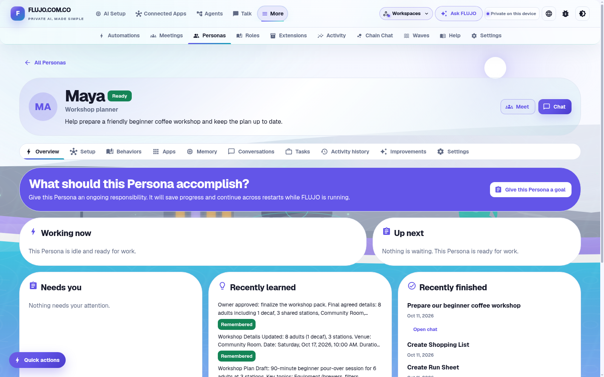](githubpages/film/media/walkthrough/act5-maya-desk.png)

[Follow Maya's workshop example](docs/journeys/persona.md). Its three “days” are compressed demonstration sessions, with operator review and corrections; they do not establish unattended reliability over elapsed days.

### Waves — experimental

See flows and their relationships in one place, or explore planned timing in the Day view. The overview is read-only; forecasts are distinct from execution results.

[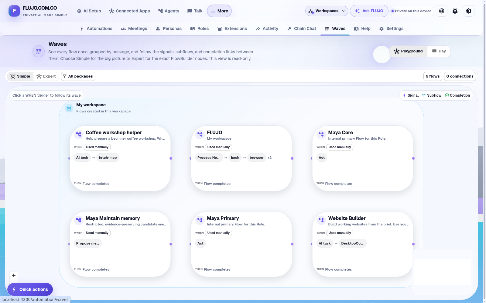](githubpages/film/media/walkthrough/act5-waves-overview.png)

### External tool integration

Reuse FLUJO from Cline, Roo Code, Cursor, an OpenAI SDK client or another compatible MCP client.

| Surface | Use |
| --- | --- |
| `http://localhost:4200/v1` | Select a `flow-<your-flow-name>` model to run an agent through the OpenAI-compatible API |
| `http://localhost:4200/mcp-flows` | Access flows through FLUJO's MCP transport |
| `http://localhost:4200/mcp-proxy/<server-name>` | Reuse an explicitly exposed MCP server's tools and resources; the proxy is currently localhost-only |

The default local profile accepts a compatibility API-key value; that value is not authentication. An explicitly enabled owner policy requires an issued, scoped bearer. These interfaces have exposure and workspace-access rules; see the [API reference](docs/api-reference/README.md).

FLUJO connects **to Ollama** as a model provider. It does not expose an Ollama-compatible server endpoint.

#### Built-in API documentation

Open **/docs** in the running app for searchable HTTP documentation with examples for chat, conversations, models, flows, MCP, automations and administration. The reference is curated; the [route inventory](docs/api-reference/routes.md) covers the source handlers.

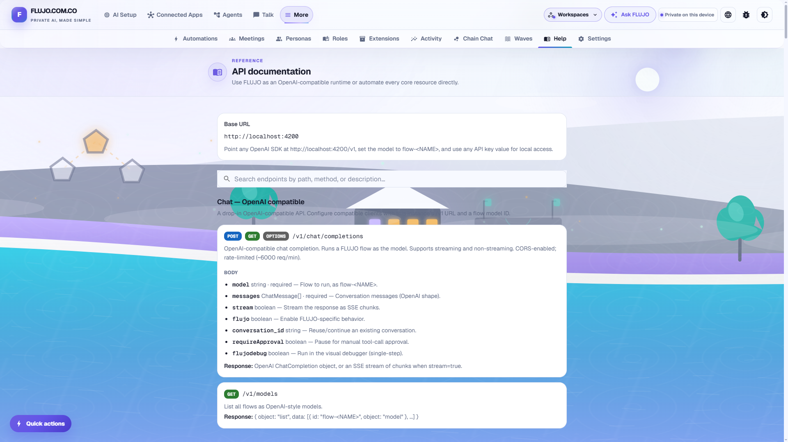

[Developer and integration guide](docs/start-here/developers.md)

<a id="-getting-started"></a>

## Getting started and examples

1. Install FLUJO and open **AI Setup → Connect AI**. Save and test a model connection.
2. Add any tools your task needs under **Connected Apps**; test an operation before attaching them.
3. Open **Agents → Start simple**, describe the steps, bind their models and tools, name the agent and **Save**.
4. Choose **Try it** to talk to the agent. Return to its editor to change instructions or use the Expert graph.
5. After a manual run succeeds, add an automation or connect an external client if your task needs it.

Choose an example:

| Guide | What it demonstrates |
| --- | --- |
| [First AI-only conversation](docs/getting-started/README.md) | The shortest path from a model connection to a reply |
| [Coffee-reading helper](docs/journeys/first-agent.md) | Install a web-reading tool from GitHub, use it in chat and check the answer against its source |
| [Website Builder](docs/journeys/website-builder.md) | Reuse a general agent for a site brief, then review and revise its local output |
| [Plan with Maya](docs/journeys/persona.md) | Continuing context, memory and goals across resumed demonstration sessions |

[Everyday use and recovery](docs/start-here/using-flujo.md) · [Compare working styles with Claude, Goose, Dify, n8n, OpenClaw and Hermes](docs/start-here/compare.md) · [Full documentation](docs/README.md)

<details>
<summary>Installation, updates and maintenance</summary>

The detailed instructions remain available for each setup:

- [Windows installer, PowerShell options and updates](docs/start-here/windows.md)
- [Linux/macOS installation and updates](docs/start-here/unix.md)
- [Run the published npm package](docs/start-here/npm.md), including data paths and embedded launcher settings
- [Build from source](docs/start-here/source.md), with supported Node versions and manual setup
- [Docker](docs/start-here/docker.md), including persistent volumes, rebuilds, tool runtimes and Apps ports
- [Corporate proxies, custom certificates and browser-download recovery](docs/start-here/proxy.md)
- [Windows uninstall and backup guidance](docs/start-here/uninstall.md)

</details>

## Privacy and workspace controls

- **Local workspace storage:** models, agents, chats and settings live on your computer. Cloud providers and remote tools receive the data required for their requests and may charge separately.
- **Credential protection:** set your own encryption password. The public default is obfuscation, not a private vault; historical plaintext records need explicit repair. [Encryption and migration](src/utils/encryption/README.md).
- **Shared values:** store a credential or value once in **Settings → Global variables**, then bind it into model and app configurations.
- **Workspaces and backups:** organize projects separately, back up and restore them. Backups and portable-worker snapshots can contain credentials. [Workspaces](docs/features/workspaces.md) · [Transfer rules](docs/features/hot-clone-workspace.md).
- **Usage sharing:** an anonymous daily-active pulse is on by default. It contains version/platform/install metadata and a daily-changing identifier, not prompts, keys or conversation content. Control sharing and its notice in **Settings → Privacy & Usage**.

<a id="network-exposure"></a>

### Network exposure

The default installation is for one trusted operator on localhost, without a sign-in screen or separate user accounts. **Settings → Network access** controls exposure, not authentication. Deliberate LAN or public exposure needs appropriate authenticating controls; public/shared hosting acceptance remains open. Workspace selection does not provide user isolation.

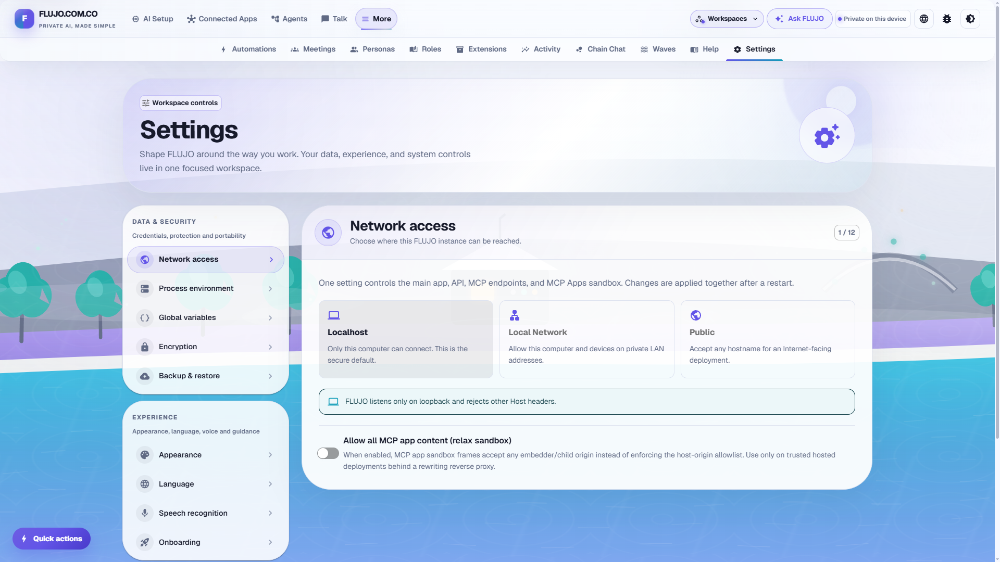

[Network deployment guide](docs/start-here/network.md) · [Privacy and costs](docs/start-here/privacy.md) · [Security policy](SECURITY.md)

## Roadmap and maturity

| Capability | Current scope |
| --- | --- |
| Model connections, chat and visual agents | Available, including branching, loops, subflows, debugging and tool approvals |
| AI-assisted flow generation | Available; review the generated steps and tool access |
| MCP connections and interactive Apps | Available within the server's capabilities and documented protocol limits |
| Automation triggers | Available while the server runs; inspect results and recover failures |
| Workspaces and portable workers | Available within their data, authentication and credential-transfer boundaries |
| Meetings, Personas, Roles, persistent goals and Waves | Experimental; supervision and recovery can be needed |
| MCP Skills, resumable subflow sessions and selected generators | Opt-in experiments; see their feature flags and guides |

[Project status](docs/project-status.md) · [Release history](CHANGELOG.md) · [Persona acceptance criteria](docs/performance/persona-goal-endurance-acceptance.md)

### Project vision — Soon(tm)

**World: one avatar, one voice, and work that happens in the background.** One virtual home to bring everything into one place.


**Swarms: bring FLUJO into the cloud.** One machine, ten machines, a hundred machines — with a long-term ambition of thousands of agents working together, using supported Claude/Codex subscription access and a copy of your local MCP configuration.


These are longer-term ambitions. Related directions include real-time voice, deeper roots/checkpoint support and builds suited to smaller devices. See the [current project status](docs/project-status.md) or [share a feature request](https://github.com/mario-andreschak/FLUJO/issues).

## Contributing and community

Contributions, bug reports and ideas are welcome. [Read the contributor guide](docs/contributing/README.md), pick a [starter task](docs/contributing/starter-backlog.md), or open a pull request. Maintainers have a separate [release procedure](docs/npm-release.md).

- [GitHub issues](https://github.com/mario-andreschak/FLUJO/issues) · [Discord](https://discord.gg/KPyrjTSSat)
- Project author: [mario-andreschak](https://github.com/mario-andreschak) · [LinkedIn](https://www.linkedin.com/in/mario-andreschak-674033299/)
- [Original product film and studio](https://flujo.com.co/short/) · [Guided walkthrough](https://flujo.com.co/film/)
- [Developer notes, response formatting and debugging options](docs/start-here/developers.md#response-and-debugging-options)

FLUJO is [MIT licensed](LICENSE), powered by [PocketFlow](https://the-pocket-world.github.io/Pocket-Flow-Framework/), and built with Cline, Claude Code and a lot of love.

### Bonus: “A sad song about MCP”

[](https://www.youtube.com/watch?v=boOS9XHQdZc)

## Star History

<a href="https://www.star-history.com/?repos=mario-andreschak%2Fflujo&type=date&legend=top-left">
 <picture>
   <source media="(prefers-color-scheme: dark)" srcset="https://api.star-history.com/chart?repos=mario-andreschak/flujo&type=date&theme=dark&legend=top-left" />
   <source media="(prefers-color-scheme: light)" srcset="https://api.star-history.com/chart?repos=mario-andreschak/flujo&type=date&legend=top-left" />
   
 </picture>
</a>

## Ecosystem

[](https://mseep.ai/app/mario-andreschak-flujo)
[](https://mseep.ai/app/3f62578d-605f-474c-9472-c5e40df60ee0)
