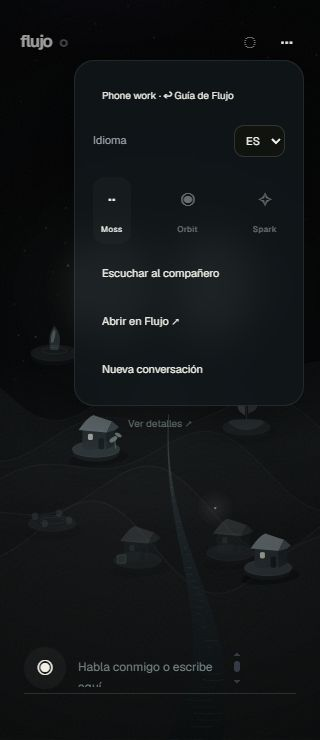
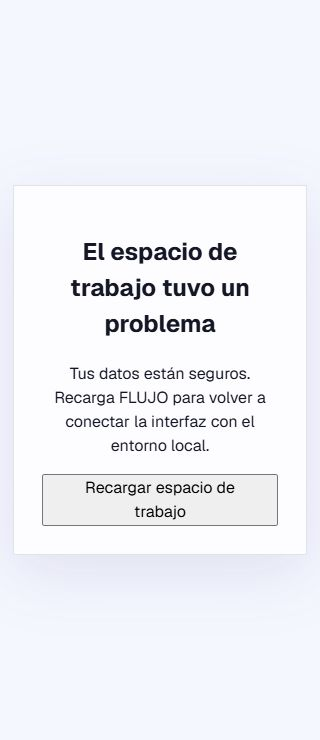

# Phone World and voice integration — PR #814

The remaining phone integration is composed onto main 3.46.3, preserving current World, local speech, allowance, owner authentication, MCP, dependency and snapshot behavior. The historical 3.46.2 backport remains recoverable at `197e00f65976a7d35498e9e560ea029b7e82cb57`; this integrated application must not replace a 3.46.2 worker whose snapshot requires that version.

The standalone mounted-host launcher still uses the existing Node 22 native command and `/api/avatar/remote/*` contract. Those remote route/service and owner credential schema sources are unchanged from the retained 3.46.2 backport. The launcher adds the missing fixed phone voice mapping, injecting both the private snapshot bearer and a raw, workspace-bound `voiceGrant` from its private configuration. The grant has only `avatar:voice` scope in the worker's existing owner policy. Browser session facts never contain either capability. Direct native voice, encoded aliases and write upgrades cannot bypass that grant; CSRF, origin, workspace, retirement and stream cancellation remain enforced. No snapshot/version compatibility guard is changed.

Phone admission precedes workspace providers. Failed admission offers localized retry, native writes carry the admitted workspace, and ordinary World retains its current local voice behavior when phone hosting is off.

## Local qualification

- Exact application input baseline: main `d3e5c64ec52f08de16c221140d99d7ea788d80c5`, with this phone batch; Node 22.23.3, Next 16.4.0, Jest 30.5.2. Matching installed dependency graph copied into the owned checkout with local workspace links. No primary source, settings, service or credential changed.
- Full application typecheck and zero-warning lint for changed source/tests pass. 86 focused frontend, transport, remote voice and native voice tests plus 11 real-loopback host tests pass. The loopback host tests use synthetic upstreams; they are distinct from real provider acceptance below.
- Inspected non-container application/five-MCP build passes under the shared process-held lease. First wall time 406.5 seconds includes one 90-second lease retry; final wall time 1,790.2 seconds includes lease contention. These are elapsed times, not compiler CPU times or additive with concurrent checks.
- A production 3.46.3 worker genuinely restored an encrypted, controlled snapshot and reached ready. Actual private bootstrap, World, workspace and independently granted voice availability returned 200; missing CSRF returned 403.
- Existing authorized OpenRouter `or_key` was read privately using the previously qualified #1108 procedure, then held only in the owned child environment and encrypted model storage. No new account, API key, payment, Claude credential work, primary mutation, full/online CI, image build or installed-release suite was performed.
- Real native audio output returned HTTP 200 in 2.202 seconds, 170,400 PCM bytes / 3.55 seconds, 15 audio chunks and complete captions. Feeding that generated WAV through real native speech input returned the matching transcription in 1.363 seconds.
- The authenticated 390 px browser used the existing flow/model controllers for real non-Claude conversation replies. Canonical result receipt, narration and playback acknowledgement each returned 200. Spanish 320 px World has no horizontal overflow. Revoking the owned test grant retired the client into its localized retry screen; retry target height is 52 px. No missing-grant loopback fallback occurred.

## Deployment boundary

The historical Fly app `o-flujo-swarm-worker1-20261003` returned 404 to a current authenticated Machines API read. This does not establish deletion or qualify its deployed 3.46.2 phone session/provider behavior. This audit qualifies the source-built current application and standalone host contract; it makes no new image, installed application, physical-phone fleet or historical worker deployment claim. Those release/deployment checks remain separate and their security gates are preserved.
