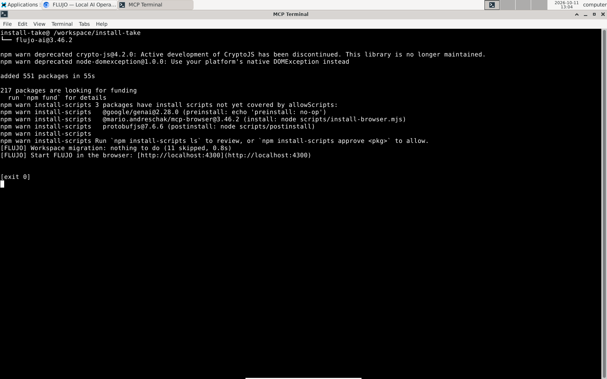
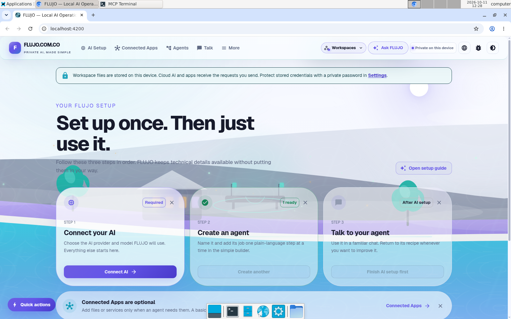
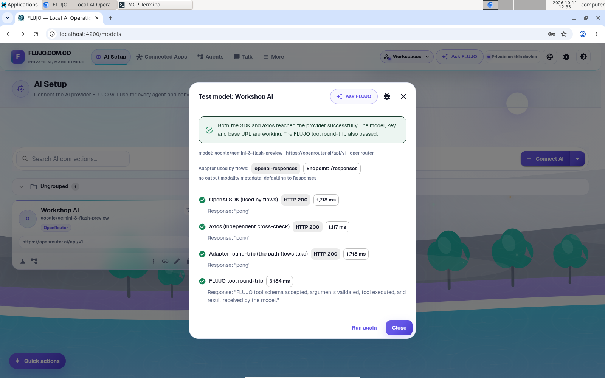
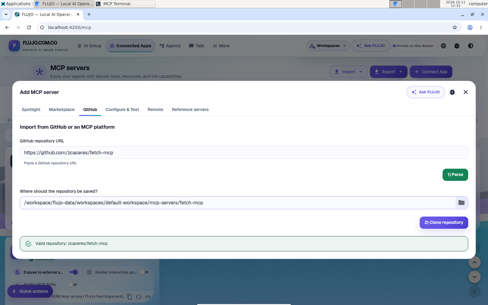
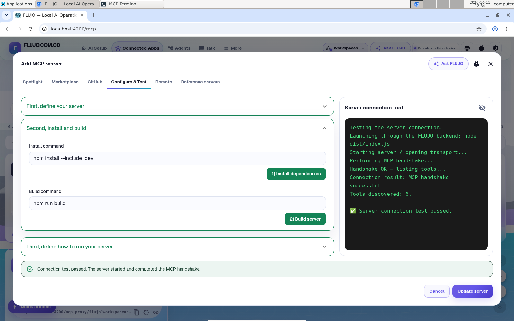
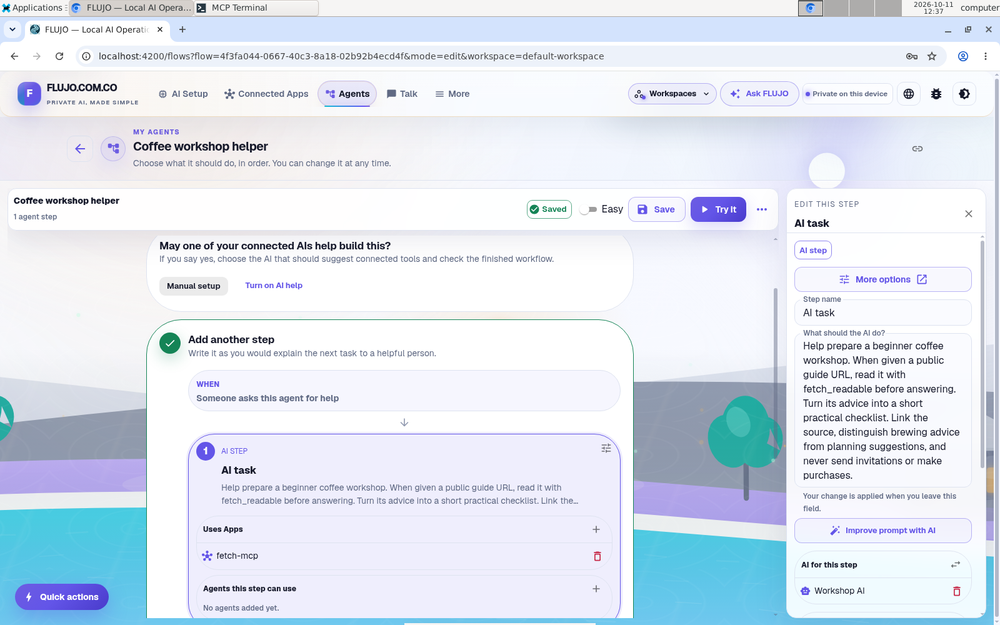
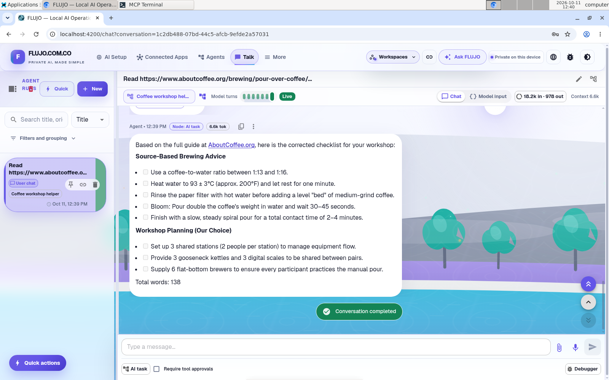

# Your first useful helper

Prepare a small coffee workshop with an agent that can read a public guide and turn it into a checklist. You will install FLUJO, connect an AI, install a tool from GitHub, and use that tool in chat.

**MCP** is the connection standard behind FLUJO's connected apps. Here, the app gives your helper one useful ability: reading a web page.

Recorded on October 11, 2026, using the published **FLUJO 3.46.2** package in a fresh Linux desktop. The screenshots below are real 1600 × 1000 captures. Select an image to inspect it at full size.

## 1. Open FLUJO and test an AI

[Install FLUJO](../start-here/install.md), open [localhost:4200](http://localhost:4200), and keep its server running.

The original installation happened before the main recording. A separate npm installation of **3.46.2** into a new package directory with fresh app data was recorded afterward, using the existing Node/npm tooling and download cache. It reached a [successful first launch](../../githubpages/assets/journeys/00b-clean-install-home.png) on port **4300** after an initial attempt on 4201 found the main demo's sidecar already using that port.

[](../../githubpages/assets/journeys/00-install-receipt.png)

The remaining walkthrough follows the original demo at **localhost:4200**:

[](../../githubpages/assets/journeys/01-installed-home.png)

Open **AI Setup → Connect AI**. Choose a provider you have access to, or a local Ollama model. Save it, then use **Test model** on the model card. Continue when the test succeeds. A saved connection or a loaded model list does not prove that the account has allowance for a request. If a test reports a quota or credit error, resolve it with the provider or test another connection before continuing.

Cloud-model tests and conversations may use quota or incur provider charges. Keep credentials in the connection fields. [Model setup help](../features/models/connecting.md).

The recorded connection is **Workshop AI**, using OpenRouter's `google/gemini-3-flash-preview`. Its model and tool tests passed. An earlier provider returned a quota error, so the example continued with this working connection.

[](../../githubpages/assets/journeys/02-ai-test.png)

## 2. Install the web-reading app from GitHub

In the recorded **FLUJO 3.46.2** interface, open **Connected Apps → Connect App → I have connection details → In a GitHub repository**. Paste this into **GitHub URL**:

```text
https://github.com/zcaceres/fetch-mcp
```

Review the repository owner and setup instructions. This is an external server whose install/build commands run on the FLUJO host. Its source build uses **Bun**, an additional prerequisite; have it available on the machine running FLUJO before building. [Fetch server documentation](https://github.com/zcaceres/fetch-mcp).

Choose **1) Parse**, then **2) Clone repository**.

[](../../githubpages/assets/journeys/03-github-url.png)

The recorded setup needs one correction: automatic detection fills **Install command** with `npm install -g mcp-fetch-server`. Replace it with:

```bash
npm install --include=dev
```

That installs the dependencies in the cloned repository, including what its source build needs. Keep **Build command** as `npm run build`. Choose **1) Install dependencies**, then **2) Build server**. This is the corrected setup used in the recording; automatic detection did not complete it unchanged. If a command fails, read its error before continuing or retrying.

Under **Third, define how to run your server**, select **Standard IO**, set **Run command** to `node`, and add `dist/index.js` under **Arguments**. It runs from the cloned repository directory. [Inspect the saved run settings](../../githubpages/assets/journeys/04b-mcp-run-config.png); this supplementary capture reopened the saved configuration, then canceled without changes. Keep **Bun** available for the build step; it is separate from the standard FLUJO prerequisites. Choose **3) Test run**. Cloning already created the configuration in this recorded path, so choose **Update server** to save the corrected settings.

[](../../githubpages/assets/journeys/04-mcp-test.png)

This test discovered six tools. It confirms that the server starts and connects; the next check verifies that it can read the page you need.

## 3. Test one real page

Open the connected app's detail view and select **fetch_readable**. Use the National Coffee Association's public pour-over guide:

```json
{
  "url": "https://www.aboutcoffee.org/brewing/pour-over-coffee/",
  "max_length": 20000
}
```

Run the tool. Check that its result contains the coffee article, rather than a login page, blocked request or error. Use the larger limit so the brewing steps near the end are included; if a result is cut off, retrieve the rest before asking for source-based advice. Successful connection and successful page reading are separate checks.

## 4. Make the Workshop helper

1. Open **Agents → Start simple**. Use the **Easy** editor; choose **No, I'll build it myself** if asked whether AI should help.
2. In **Workflow goal**, describe the job: `Read the full source I provide with fetch_readable, using max_length 20000. If it is cut off, retrieve the rest before answering. Help me prepare a small beginner coffee workshop. Separate source facts from your suggestions; do not guess missing advice or send invitations or make purchases.` Choose **Create goal step**.
3. Select the **AI step**. Under **AI for this step**, use **Choose an AI** and select your tested connection.
4. Use **+** beside **Uses Apps** to add **fetch-mcp**. The instructions above tell the helper to use its **fetch_readable** tool.
5. Set **Agent name** to `Coffee workshop helper`, save, and choose **Try it** in the toolbar. The initial setup may also offer **Try my agent**.

[](../../githubpages/assets/journeys/05-agent-app.png)

The screenshot shows the original instruction. The longer-source instruction above incorporates what the recorded run taught us.

## 5. Ask for something you can use

Use this prompt, which incorporates the correction from the recorded run:

```text
Read the full guide at https://www.aboutcoffee.org/brewing/pour-over-coffee/
with fetch_readable, setting max_length to 20000. If it is cut off, retrieve
the remainder before answering. Help me prepare a 90-minute beginner coffee
workshop for six adults at three shared stations. Make a short checklist.
Link the source and separate its brewing advice from workshop suggestions.
Do not guess missing source details, send invitations or make purchases.
```

Look for both a successful tool result and the assistant's checklist. The answer should be something you can act on, with a source you can check. An answer from the model's general knowledge does not show that this tool connection worked.

**The first answer needed correction.** The agent initially used the default 5,000-character extract and guessed a brewing ratio from incomplete material. A real follow-up requested `max_length: 20000` and produced a corrected checklist: the source gives a coffee-to-water ratio of **1:13–1:16** and a **30–45 second bloom**. The final answer separates that brewing advice from suggestions about arranging the workshop. [Check the NCA source](https://www.aboutcoffee.org/brewing/pour-over-coffee/).

[](../../githubpages/assets/journeys/07-verified-checklist.png)

**One more detail needs review:** the pictured answer combines the target water temperature with a one-minute rest. The source gives **93 ± 3°C as the target**; its rest instruction applies **after bringing water to a full boil**. Do not cool water for an extra minute after already reaching the target. This is an actual model answer with a remaining error, not a guarantee that every item is correct. [Read the source's kettle guidance](https://www.aboutcoffee.org/brewing/pour-over-coffee/).

If the agent skips the tool, return to its AI step and check the binding. If the page read fails, test the app directly before changing the agent. Model, login and quota errors belong in **AI Setup**. [Recovery guide](../start-here/using-flujo.md#when-something-goes-wrong).

## Keep the useful part

Your model, connected app and agent remain saved. Return through **Talk → New** and choose **Coffee workshop helper**, or reuse the same connections in another agent. You can inspect the run, enable tool approvals, and use the Expert graph later.

Next, [work with Maya on the workshop plan](persona.md). That guide uses an experimental Persona across three compressed demonstration sessions.

## About the recorded example

This first-use journey reached a successful live tool call and an assistant checklist that required source review and correction. It needed a manual installation-command correction, a working provider connection, and a longer source read. These are part of the example, not hidden setup steps.

The [capture manifest](evidence/capture-manifest.json), [provenance notes](evidence/capture-provenance.md) and [runtime evidence](evidence/journey-runtime-evidence.json) record the installation, source revision, model, calls, outputs and later retakes. The screenshots use published **3.46.2**; the documentation source has a **3.46.3** version badge. The software was operated by an agent, including the review steps. The separate [Persona journey](persona.md) reached a completed goal and a reviewable workshop pack.

[Start here](../start-here/README.md) · [Privacy and costs](../start-here/privacy.md)
