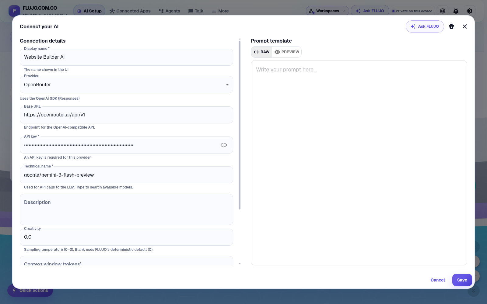
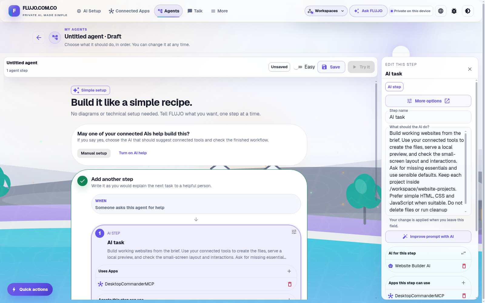
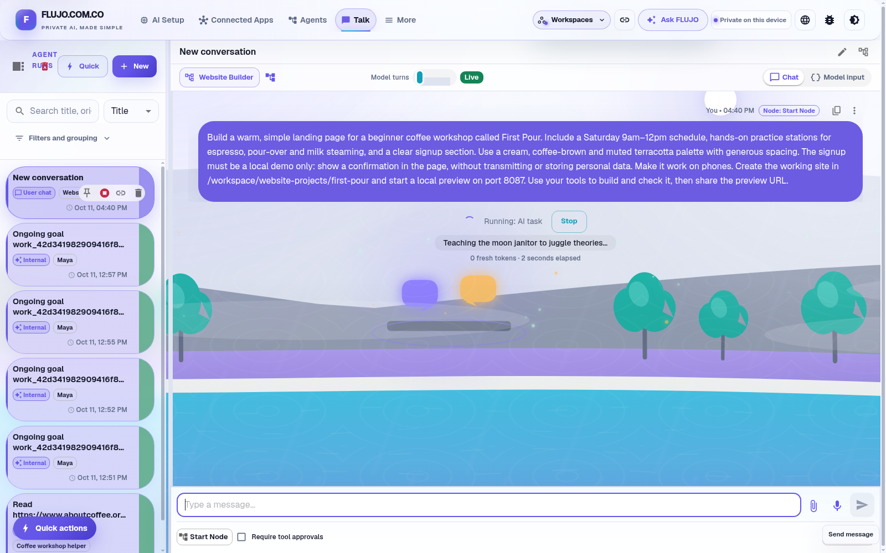
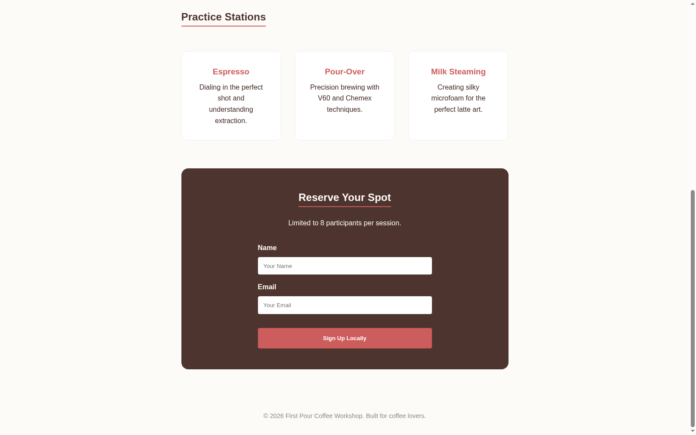
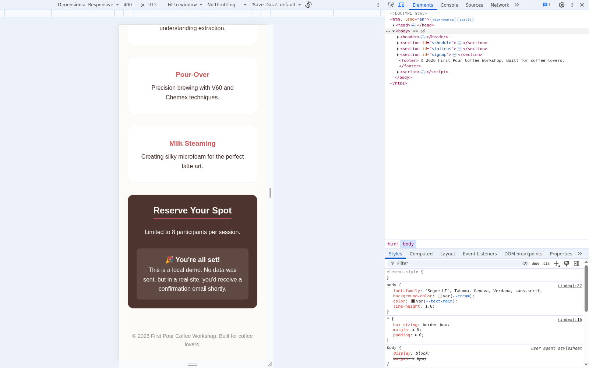

# Build websites with a reusable agent

A reusable Website Builder keeps the general approach in its saved instructions. Each chat supplies a different site's brief: its audience, content, appearance and interactions. Start by connecting the AI that will follow those instructions.

Select any screenshot to inspect the whole application at full size.

## 1. Connect and test your AI

[Install and open FLUJO](../start-here/install.md), then choose **AI Setup** in the top navigation. Keeping the model connection here lets you use it in more than one agent.

[](../../githubpages/film/media/walkthrough/act1-dashboard.png)

Choose **Connect AI → I'm an expert** to open the full connection form used in this recording. Fill in:

| Field | Recorded setting |
| --- | --- |
| Display name | `Website Builder AI` |
| Provider | `OpenRouter` |
| Base URL | `https://openrouter.ai/api/v1` |
| API key | Your own OpenRouter credential, entered privately |
| Technical name | `google/gemini-3-flash-preview` |

**Website Builder AI** names the model connection you will select for your agent. Other providers have their own credentials and model names; see [connection choices](../features/models/connecting.md). Tests and later conversations can use provider allowance or incur charges. [Privacy and costs](../start-here/privacy.md).

[](../../githubpages/film/media/walkthrough/act1-ready-to-save.png)

Choose **Save**, then **Test model** (the flask icon). Continue when the provider checks and **FLUJO tool round-trip** pass. This checks the connection and a diagnostic tool exchange; connected apps still need their own operation checks.

[](../../githubpages/film/media/walkthrough/act1-model-test-success.png)

<details>
<summary>Model troubleshooting and recording notes</summary>

If a test fails, check the saved credential, provider access and model selection, then save and test again. Our first recorded test returned **HTTP 401, “User not found”**, and skipped the tool check. Re-entering the credential privately, saving and retrying produced the successful result above. The exact cause of the first credential failure was not established.

Recorded on **October 11, 2026**, in published **FLUJO 3.46.2**. The existing workspace already contained agents and another model connection. These are real application captures operated by an agent; the public images keep credentials masked. The [setup manifest](evidence/walkthrough-act1-manifest.json), [opening clip record](evidence/walkthrough-opening-clip.json), [model-setup clip record](evidence/walkthrough-model-setup-clip.json) and [model-test clip record](evidence/walkthrough-model-test-clip.json) identify the completed actions and their evidence.

</details>

## 2. Connect file and terminal tools

Desktop Commander supplies tools for editing files and running commands. These let a website agent create pages and start a local preview.

Open **Connected Apps → Connect App → I have connection details → In a GitHub repository**. Enter:

```text
https://github.com/wonderwhy-er/DesktopCommanderMCP
```

Choose **1) Parse**, note the destination folder, then **2) Clone repository**. Use the destination shown on your computer; the `/workspace/...` path in the recording belongs to the demo.

[](../../githubpages/film/media/walkthrough/act2-github-parsed.png)

In **Configure & Test**, set **Install command** to `npm install --include=dev` and **Build command** to `npm run build`. Choose **1) Install dependencies**, then **2) Build server**. These commands prepare the repository on the machine running FLUJO.

Use these launch settings:

| Setting | Value |
| --- | --- |
| Server name | `DesktopCommanderMCP` |
| MCP server root path | The destination folder containing the built clone |
| Transport type | `Standard IO` |
| Run command | `node` |
| Arguments, as separate entries | `dist/index.js` and `--no-onboarding` |

Choose **3) Test run**, then **Update server** to save the GitHub configuration. The recorded test connected successfully and discovered **26 tools**. Confirm **DesktopCommanderMCP** appears as **Connected** in the app list. The recording's final connection used the recovery steps below.

[](../../githubpages/film/media/walkthrough/act2-desktop-commander-connected.png)

<details>
<summary>Tool setup troubleshooting and recording notes</summary>

The first connection test passed, but the operator missed **Update server** and clicked outside the dialog. The recording then reopened **Connect App → I'm an expert → Configure & Test** and reused the built clone with the launch settings above. Install and build commands were left empty because the clone was already built.

During that entry, `mcpservers` was typed instead of `mcp-servers`, causing a transport error. Pasting the correct folder, testing again and choosing **Add server** produced the connected card. [Inspect the successful test and Add server control](../../githubpages/film/media/walkthrough/act2-recovery-test-passed.png). Manual re-entry is the path recorded here, not a requirement for every installation.

The original GitHub configuration showed **Update server**; the later manual configuration showed **Add server**. Check the actual saved card as well as the test result. The build reported Desktop Commander **0.2.52**. The [tool-setup manifest](evidence/walkthrough-act2-manifest.json) and [approved tool-footage record](evidence/walkthrough-tool-clip.json) preserve the recovery and successful connection.

</details>

## 3. Save a reusable Website Builder

Open **Agents → Start simple → No, I'll build it myself**. In **Workflow goal**, enter the approach you want this agent to reuse. Before pasting the recorded goal below, replace `/workspace/website-projects` with your own project folder on the machine running FLUJO.

```text
Build working websites from the brief. Use your connected tools to create the files, serve a local preview, and check the small-screen layout and interactions. Ask for missing essentials and use sensible defaults. Keep each project inside /workspace/website-projects. Prefer simple HTML, CSS and JavaScript when suitable. Do not delete files or run cleanup commands.
```

Keep each site's audience, content and design brief for its chat.

Choose **Create goal step**. In the step inspector, select **Website Builder AI** under **AI for this step**. Use **Apps this step can use → +** to attach **DesktopCommanderMCP**.

[](../../githubpages/film/media/walkthrough/act3-tool-attached.png)

Close the step inspector, set **Agent name** to `Website Builder`, and choose **Save**. Confirm the **Saved** status.

[](../../githubpages/film/media/walkthrough/act3-agent-saved.png)

Optionally, switch to **Expert** to see the same saved agent as a diagram: Start, one AI task, its connected app and Finish. [Inspect the Expert view](../../githubpages/film/media/walkthrough/act3-expert-graph.png), then return to **Easy**. Choose **Try it** to open a chat with Website Builder selected.

<details>
<summary>Agent setup and recording notes</summary>

This agent uses one AI step and one connected app. Attaching DesktopCommanderMCP enabled all 26 discovered tools, including its configuration tools. The project-folder instruction guides the agent; it does not enforce file or terminal access limits.

The [agent-setup manifest](evidence/walkthrough-act3-manifest.json) and [approved agent-footage record](evidence/walkthrough-agent-clip.json) record the exact goal, model and app selections, explicit save, both views and entry into an empty chat. These setup screenshots establish that the agent was ready to use; its website output is a separate check.

</details>

## 4. Give it a website brief

Use the chat for the particular site you want. Before pasting our recorded brief, substitute a project folder inside the location you chose for your agent:

```text
Build a warm, simple landing page for a beginner coffee workshop called First Pour. Include a Saturday 9am–12pm schedule, hands-on practice stations for espresso, pour-over and milk steaming, and a clear signup section. Use a cream, coffee-brown and muted terracotta palette with generous spacing. The signup must be a local demo only: show a confirmation in the page, without transmitting or storing personal data. Make it work on phones. Create the working site in /workspace/website-projects/first-pour and start a local preview on port 8087. Use your tools to build and check it, then share the preview URL.
```

Send the message and follow the tool results in chat.

[](../../githubpages/film/media/walkthrough/act4-build-started.png)

## 5. Review and improve the page

Open the preview URL from chat. If the run finishes without giving you a link, ask the same agent for it. A completed tool call is a useful checkpoint; opening the page shows what was actually built.

Check the page against your brief:

- Read the schedule and all three practice stations.
- Try the signup with empty fields, then with fictional demo details. Check the confirmation and reload the page.
- Narrow the browser to a phone-sized width and check the text, buttons and form.

Give corrections in the same chat, then reload and check the revised page. For First Pour, our review requested visible **Name** and **Email** labels and the current **2026** footer year. Website Builder made those changes through its connected tools.

[](../../githubpages/film/media/walkthrough/act4-final-desktop-labels.png)

The revised page passed desktop and **400 × 913** responsive-browser checks: its form displayed a local confirmation, reset on reload, and fit the narrow layout. This is a signup demonstration; it does not register workshop attendees. Keep the saved Website Builder instructions general so you can use the agent for another site.

[](../../githubpages/film/media/walkthrough/act4-final-responsive-confirmed.png)

<details>
<summary>Build review and recording notes</summary>

The initial run completed `create_directory`, `write_file` and `start_process`, but showed no final prose or preview URL. A follow-up in the same chat returned the link. The example's preview ran at `http://localhost:8087` on the machine serving the site. [Inspect the final response and preview link](../../githubpages/film/media/walkthrough/act4-repair-verified-response.png).

The first label/footer revision had overlapping file edits: the footer change was lost and extra text appeared after the page. The operator asked the same agent to repair it in one write and read it back. The repaired source was 6,793 bytes; source comparison found the intended labels, styling and footer changes, with the signup script unchanged. The site was repaired through the agent's tools, without a separate hand edit.

The capture operator performed the browser checks. The narrow view used browser emulation, not a physical phone. Empty-field validation was tested on the original draft; final checks repeated submission and reload on desktop and at the narrow width. Source inspection found no network or storage calls in the unchanged signup script; visible confirmation and reload checks alone would not establish that. The [build evidence](evidence/walkthrough-act4-manifest.json) and [approved final-site footage](evidence/walkthrough-site-clip.json) distinguish the original draft from the revised source and its checks.

</details>

## 6. Explore what comes next

Open **More** to explore other ways to use your agents. Some entries require **Settings → Enable experimental features**.

| Feature | What you can try |
| --- | --- |
| **Meetings** — experimental | Bring several agents into a discussion around a shared brief |
| **Automations** | Run a saved agent on a schedule or event, then check its run history; keep the FLUJO server running |
| **Personas** — experimental | Give an ongoing helper context, memory and goals; review its work and pause it when needed |
| **Waves** — experimental | Explore planned work and timing; forecasts do not establish what actually ran |

[Capabilities and limits](../start-here/capabilities.md) · [Everyday automation](../start-here/using-flujo.md#schedule-work-after-a-manual-run-succeeds) · [Maya's Persona example](persona.md)

[Start here](../start-here/README.md) · [Coffee-reading helper](first-agent.md) · [Plan with Maya](persona.md)
